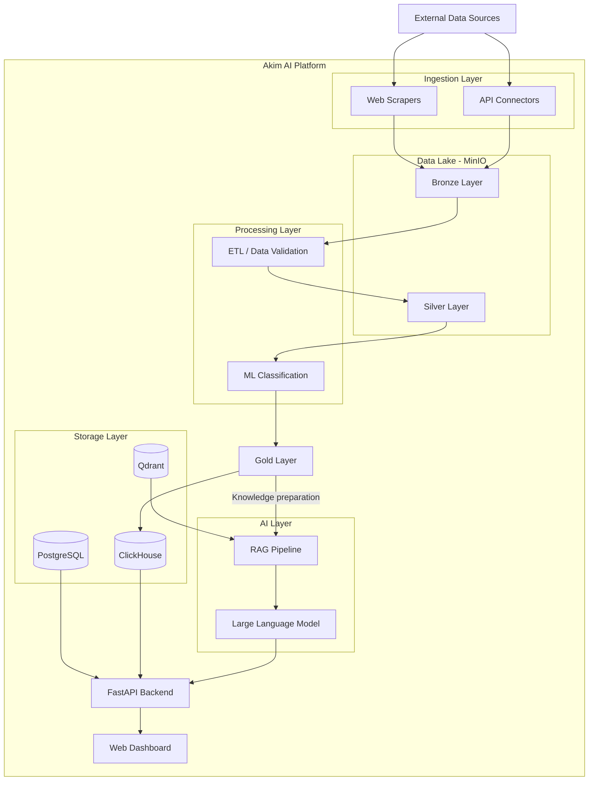

# C4 Model — Level 2: Container Diagram

## Overview

The following diagram describes the main technical components of Akim AI and their interactions.

## Container Responsibilities

| Container | Responsibility |
|---|---|
| Web Scrapers | Extract publicly accessible information |
| API Connectors | Integrate external APIs |
| MinIO | Store raw and intermediate datasets |
| ETL Processing | Validate and transform information |
| ML Classification | Categorize urban problems |
| ClickHouse | Analytical data storage |
| PostgreSQL | Operational database |
| Qdrant | Vector search and semantic retrieval |
| RAG Pipeline | Retrieve relevant municipal knowledge |
| LLM | Generate contextual recommendations |
| FastAPI | Expose backend functionality |
| Web Dashboard | Provide user interaction |

Note: This represents the proposed logical architecture. Individual components may be implemented as separate services or modules depending on development requirements.
