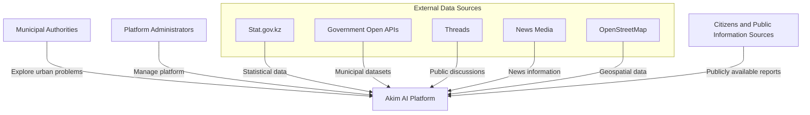

# C4 Model — Level 1: System Context

## Overview

This diagram illustrates the relationship between Akim AI, its external data sources, and its primary users.



## Primary Actors

### Municipal Authorities

Use the platform to explore recurring urban problems, analyze their geographical distribution, and receive AI-generated recommendations.

### Platform Administrators

Manage data sources, platform configuration, and system operations.

### External Data Sources

Provide statistical, geographical, governmental, and publicly available information for analysis.
```
