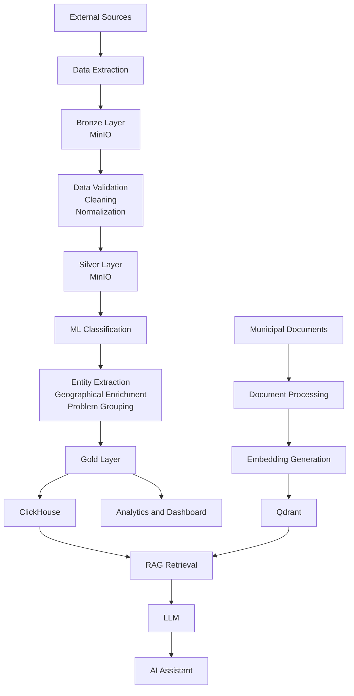

# Akim AI — Data Pipeline Architecture

## Overview

Akim AI uses a Medallion Architecture to process heterogeneous data collected from multiple public sources.

The pipeline transforms raw information into structured datasets suitable for analytical queries, machine learning, and AI-powered recommendations.

## Pipeline Stages

### 1. Data Extraction

Information is collected from:
- Government statistical platforms.
- Public APIs.
- Social media.
- News websites.
- OpenStreetMap.

### 2. Bronze Layer

Raw data is stored in MinIO without significant modifications.

### 3. Silver Layer

Data is validated, cleaned, normalized, and deduplicated.

### 4. ML Classification

Machine learning models classify information and extract relevant entities.

### 5. Gold Layer

Enriched datasets are prepared for analytical queries and stored in ClickHouse.

### 6. AI Knowledge Processing

Relevant municipal documents are processed separately through an embedding pipeline and stored in Qdrant.

### 7. Application Consumption

The backend retrieves information from analytical and vector databases to support dashboards and AI-generated recommendations.

## Data Flow Diagram

## Data Quality and Reliability

The pipeline is designed to support:

- Schema validation.
- Duplicate detection.
- Source tracking.
- Data freshness monitoring.
- Processing error handling.
- Reprocessing of historical datasets.

## Orchestration

Apache Airflow will coordinate extraction, transformation, classification, and loading workflows.

Each pipeline stage should be independently testable and maintainable.
